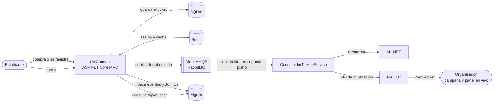

# 🎓 UniConnect — Plataforma de Eventos Universitarios USMP
> Aplicación web MVC en .NET 10 para centralizar eventos, actividades comunitarias y oportunidades para estudiantes de la USMP, proyecto grupal 


---

## 🔗 Enlaces

| Recurso | URL |
|---|---|
| 📦 Repositorio GitHub | https://github.com/David-Clouds/UniConnect |
| 🎨 Diseño en Figma | https://www.figma.com/make/yGW4sb2DzXZM7zECkchGIt/UniConnect-web-app-design?t=JQlVb2r0avENCNDH-1 |
| 🌐 Aplicación en Render | https://uniconnect-8jmc.onrender.com |
| 🩺 Estado de los servicios | https://uniconnect-8jmc.onrender.com/api/integraciones |
| 🤖 Estado de los modelos ML | https://uniconnect-8jmc.onrender.com/api/ml/estado |


---

## 🛠️ Tecnologías

- **.NET 10** (ASP.NET Core MVC)
- **Entity Framework Core** + **SQLite**
- **Docker** (build multi-stage)
- **Git / GitHub** (ramas, Pull Requests, merges)
- **Render** (despliegue como Web Service)
- **Redis** (sesiones y caché distribuida en producción)
- **ML.NET** (clasificación y recomendación de eventos)
- **QRCoder** (código QR de los tickets)
- **CloudAMQP / RabbitMQ** (cola de mensajes `ticket.emitido`)
- **PieHost / PieSocket** (WebSocket: notificaciones en tiempo real)
- **Algolia** (buscador instantáneo de eventos y Join Us)

---

## ✨ Funcionalidades

- ✅ Registro e inicio de sesión de estudiantes.
- ✅ Visualización, búsqueda y filtros de eventos (categoría, fecha, precio).
- ✅ Detalle de evento.
- ✅ Registro a eventos gratuitos.
- ✅ Compra simulada de tickets con generación de ticket digital + código QR.
- ✅ Sección **"Join Us"**: voluntariados, comunidades y causas solidarias dentro de la USMP.
- ✅ Publicación de eventos por organizadores.
- ✅ Panel de organizador (participantes, tickets vendidos, ingresos).
- ✅ Perfil del estudiante (mis eventos, mis tickets, mis voluntariados).
- ✅ Recomendaciones personalizadas de eventos con ML.NET.
- ✅ Asistente que sugiere la categoría de un evento con ML.NET.
- ✅ API REST de eventos, comunidades, estadísticas, búsqueda y modelos de ML.
- ✅ Buscador instantáneo en la barra superior con **Algolia** (tolera errores de tipeo).
- ✅ Notificaciones en tiempo real para organizadores (**CloudAMQP + PieHost**): campana, aviso emergente y contador del panel.
- ✅ Diseño **responsive**: en el celular el menú lateral pasa a una barra inferior.
- ✅ El menú solo muestra el *Panel Organizador* a quien tiene permiso.
- ✅ El **Administrador General** puede crear eventos desde el Panel Organizador (*+ Crear evento*).
- ✅ **Chatbot "Uni"** (Google Gemini, plan gratuito): botón flotante que recomienda eventos reales, explica cómo conseguir tickets y muestra iniciativas de Join Us. Sin clave responde con reglas simples.

---

## 🏗️ Arquitectura



1. Al emitirse un ticket, la app lo guarda y publica el mensaje `ticket.emitido` en la cola **`uniconnect.tickets.emitidos`** de CloudAMQP.
2. `ConsumidorTicketsService` lee la cola, pide a **ML.NET** reentrenar las recomendaciones y avisa por **PieHost** en los canales `uniconnect-org-{id}` (organizador) y `uniconnect-admin` (administradores).
3. El navegador del organizador recibe el aviso por **WebSocket**: suena la campana, aparece un aviso emergente y sube el contador *Tickets emitidos* del panel sin recargar.
4. Cada 30 minutos (y al iniciar) los eventos e iniciativas se indexan en **Algolia**; la barra superior consulta `/api/buscar`.

Cada integración es **opcional**: sin sus claves, la app funciona igual (los tickets se procesan sin cola y la búsqueda usa la base de datos). Los avisos de PieHost no incluyen datos personales de los estudiantes.

---

## 🗃️ Modelo de datos

**`Estudiante`**
| Campo | Tipo | Descripción |
|---|---|---|
| `Id` | int | Identificador autogenerado |
| `Nombre` | string | Nombre del estudiante |
| `Correo` | string | Correo institucional |
| `Codigo` | string | Código de estudiante USMP |
| `PasswordHash` | string | Contraseña encriptada |

**`Organizador`**
| Campo | Tipo | Descripción |
|---|---|---|
| `Id` | int | Identificador autogenerado |
| `Nombre` | string | Nombre del club/organizador |
| `Correo` | string | Correo de contacto |
| `Descripcion` | string? | Descripción opcional |

**`Evento`**
| Campo | Tipo | Descripción |
|---|---|---|
| `Id` | int | Identificador autogenerado |
| `Titulo` | string | Nombre del evento |
| `Categoria` | string | Categoría del evento |
| `Fecha` | DateTime | Fecha y hora del evento |
| `Precio` | decimal | 0 si es gratuito |
| `Descripcion` | string? | Detalle adicional |
| `ImagenUrl` | string? | Imagen del evento |
| `OrganizadorId` | int | Relación con el organizador |

**`Ticket`**
| Campo | Tipo | Descripción |
|---|---|---|
| `Id` | int | Identificador autogenerado |
| `CodigoQR` | string | Código único del ticket |
| `FechaCompra` | DateTime | Fecha de generación |
| `EventoId` | int | Evento asociado |
| `EstudianteId` | int | Estudiante asociado |

**`Comunidad`** *(sección Join Us)*
| Campo | Tipo | Descripción |
|---|---|---|
| `Id` | int | Identificador autogenerado |
| `Nombre` | string | Nombre de la comunidad/causa |
| `Descripcion` | string | Detalle de la causa |
| `TipoApoyo` | string | Voluntariado, Donación, Colecta |
| `ImagenUrl` | string? | Imagen de la comunidad |

---

## 🔌 API REST

| Método | Ruta | Descripción |
|---|---|---|
| GET | `/api/eventos` | Eventos, con filtros `categoria`, `fecha`, `precioMax`, `q` y `limite` |
| GET | `/api/eventos/{id}` | Detalle de un evento |
| GET | `/api/eventos/categorias` | Categorías disponibles |
| GET | `/api/comunidades` | Iniciativas de Join Us (filtro `tipo`) |
| GET | `/api/comunidades/{id}` | Detalle de una iniciativa |
| GET | `/api/estadisticas` | Totales de la plataforma, en caché 60 s (Redis en producción, cabecera `X-Cache`) |
| GET / POST | `/api/ml/clasificar` | Sugiere la categoría de un evento a partir de su título y descripción |
| GET | `/api/ml/recomendaciones` | Eventos recomendados para el estudiante con sesión (o populares sin sesión) |
| GET | `/api/ml/estado` | Algoritmos, datos de entrenamiento y métricas de los modelos |
| GET | `/api/buscar?q=` | Búsqueda de eventos e iniciativas (Algolia, o la base de datos como respaldo) |
| GET | `/api/integraciones` | Estado de CloudAMQP, PieHost y Algolia: configurado, conectado, contadores y último error (sin claves) |
| POST | `/api/chatbot` | Chatbot: `{ "mensajes": [{ "rol": "user", "texto": "..." }] }` (máx. 10 por minuto por IP) |
| GET | `/api/chatbot/estado` | Indica si el chatbot usa Gemini o reglas |

---

## 🤖 Machine Learning (ML.NET)

| Modelo | Algoritmo | Dónde se usa |
|---|---|---|
| **Clasificación** de eventos por categoría | `SdcaMaximumEntropy` (multiclase) sobre texto con `FeaturizeText` | Panel del organizador → *Asistente de categoría* |
| **Recomendación** de eventos | `Matrix Factorization` (estudiante × categoría → interés) | Inicio → *Recomendados para ti* |

- Los modelos se entrenan al iniciar la aplicación y se reentrenan cada 15 minutos con los eventos y tickets reales de la base, sumados a un conjunto base de entrenamiento.
- Un estudiante sin tickets recibe los eventos más populares; al inscribirse a su primer evento, el modelo se reentrena y empieza a personalizar.
- Si un modelo no está disponible, la aplicación sigue funcionando sin él.

---

## 🔐 Configuración de servicios externos

Las claves **nunca** van en el código ni en GitHub. En tu PC se guardan con *user-secrets* y en Render como variables de entorno (el `__` equivale al `:` de la configuración).

| Variable en Render | Servicio | Dónde se obtiene |
|---|---|---|
| `Redis__ConnectionString` | Redis | *Internal Key Value URL* de Render, **sin** `redis://` y con `,abortConnect=false` |
| `CloudAmqp__Url` | CloudAMQP | Consola de CloudAMQP → instancia → *AMQP URL* (`amqps://...`) |
| `PieHost__ClusterId` | PieHost | Panel de PieHost → cluster → *Cluster ID* |
| `PieHost__ApiKey` | PieHost | Panel de PieHost → *API Key* (pública: la usa el navegador) |
| `PieHost__ApiSecret` | PieHost | Panel de PieHost → *API Secret* (solo servidor) |
| `Algolia__AppId` | Algolia | *Settings → API Keys → Application ID* |
| `Algolia__SearchKey` | Algolia | *Search API Key* (solo lectura) |
| `Algolia__AdminKey` | Algolia | *Admin API Key* (solo servidor, para indexar) |
| `Algolia__IndexName` | Algolia | Opcional; por defecto `uniconnect` |
| `Gemini__ApiKey` | Gemini (chatbot) | [Google AI Studio](https://aistudio.google.com/apikey) → *Create API key* (gratis, solo servidor) |
| `Gemini__Model` | Gemini (chatbot) | Opcional; por defecto `gemini-flash-latest` |

```bash
dotnet user-secrets init
dotnet user-secrets set "CloudAmqp:Url" "amqps://..."
dotnet user-secrets set "PieHost:ClusterId" "..."
# ...igual para el resto de claves
```

---

## 💻 Cómo correr localmente

```bash
cd UniConnect
dotnet restore
dotnet run --launch-profile http
```

Abre **http://localhost:5180/Cuenta/Login** (o el puerto que indique la consola).

### Demostración local en Development

Requiere el SDK de .NET 10. Ejecuta los comandos anteriores desde la carpeta que
contiene `UniConnect.csproj`. El perfil `http` establece `Development`; el arranque
aplica las migraciones y carga los datos iniciales automáticamente.

En una instalación de demostración sin estudiantes, abrir el login crea:

- Correo: **demo@usmp.pe**
- Contraseña de demostración: **Usmp2026!**

La cuenta recién creada se asigna a **DevClub USMP** únicamente si existe una sola
organización con ese nombre y no tiene responsable. Si no existe, se crea con sus
datos de demostración. Nunca recibe permisos de Administrador General.

Después del login puedes abrir **Mis Tickets** (`/Eventos/MisTickets`) y
**Panel Organizador** (`/Organizador/Panel`). Encontrarás tres tickets de demostración,
cada uno asociado a un evento distinto de DevClub USMP. Se reutilizan hasta tres
eventos existentes de esa organización y solo se crean los que falten para completar
tres; no se modifican sus fechas, precios ni otros datos. Si ya tenía más eventos,
se conservan todos y se toman los tres primeros por identificador para los tickets.

Las tarjetas y estadísticas se calculan a partir de estos registros: tres tickets
emitidos y un participante único en una instalación nueva. El número de eventos
próximos depende de las fechas de los eventos reutilizados. Los tickets son datos
de demostración, no acreditan pagos ni asistencia y no habilitan la generación de
QR. La cuenta, su asignación, los eventos que falten y los tickets se guardan en una
sola transacción.

Si ya existe cualquier estudiante, no se crea otra cuenta demo, no se cambian
contraseñas ni se conceden permisos, aunque la cuenta existente sea `demo@usmp.pe`.
El login tampoco añade eventos o tickets en esas bases existentes.
Tampoco se reemplazan responsables existentes ni se asignan organizaciones con
nombres ambiguos. Repetir la ejecución no vuelve a asignar la cuenta.

La inicialización del login comprueba que no haya migraciones pendientes y que
la migración de permisos esté aplicada. La factoría de diseño de EF usa SQLite
en memoria: `dotnet ef migrations list` sin una conexión explícita no describe
el archivo usado por la aplicación.

En **Production** (y cualquier entorno distinto de Development), abrir el login
no crea cuentas demo ni asignaciones. Las credenciales publicadas son solo para
demostraciones locales. No utilices una base de demostración con esas cuentas en
Production: cambiar de entorno no elimina cuentas ya creadas.

---

## 🚀 Despliegue en Render

| Configuración | Detalle |
|---|---|
| Runtime | Docker |
| Rama desplegada | `main` |
| Puerto | Variable de entorno `PORT` |
| Base de datos | SQLite (`uniconnect.db`); el repositorio incluye un archivo inicial, no publiques tu base local modificada |
| Variables de entorno | Las de la sección [Configuración de servicios externos](#-configuración-de-servicios-externos) |
| Verificación | `/api/integraciones` y `/api/ml/estado` |

---

## 🌳 Estructura de ramas (Git)

```
main
├── feature/login
├── feature/funcionalidades
├── feature/joinus
├── feature/mis-tickets
├── feature/panel-organizador
├── feature/checkout-qr
├── feature/api-rest
├── feature/ml-net
└── feature/tiempo-real-busqueda
```

Cada integrante trabaja en su rama y abre un Pull Request hacia `main` para integrar cambios.
